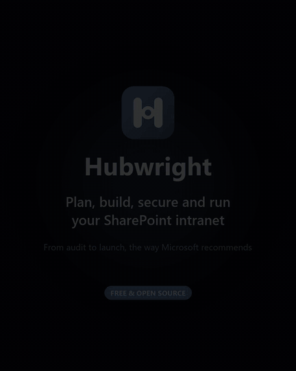
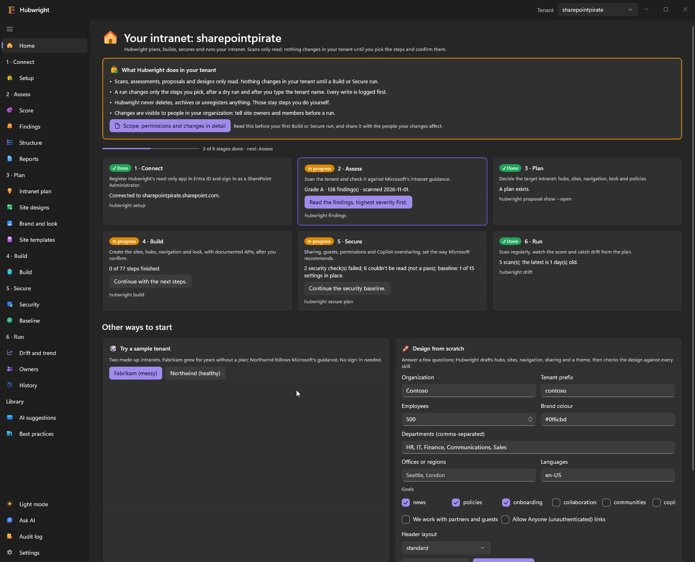
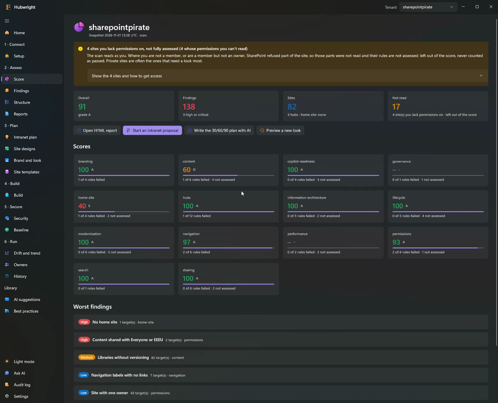
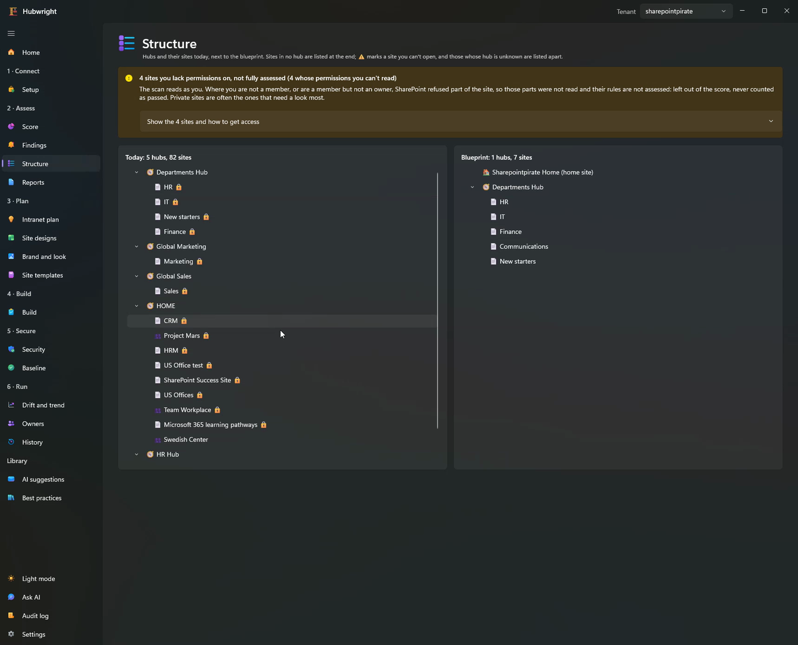
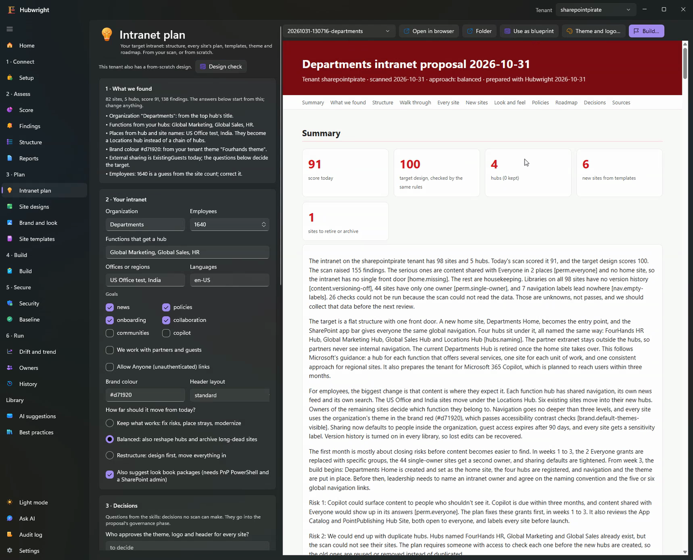
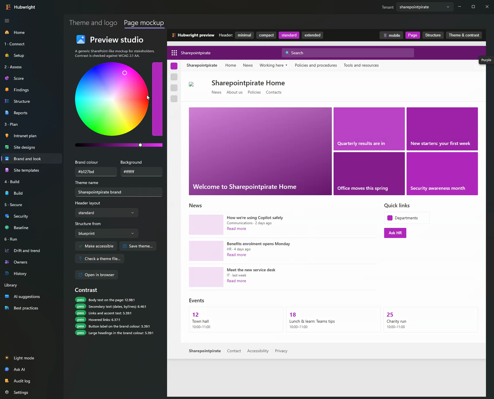
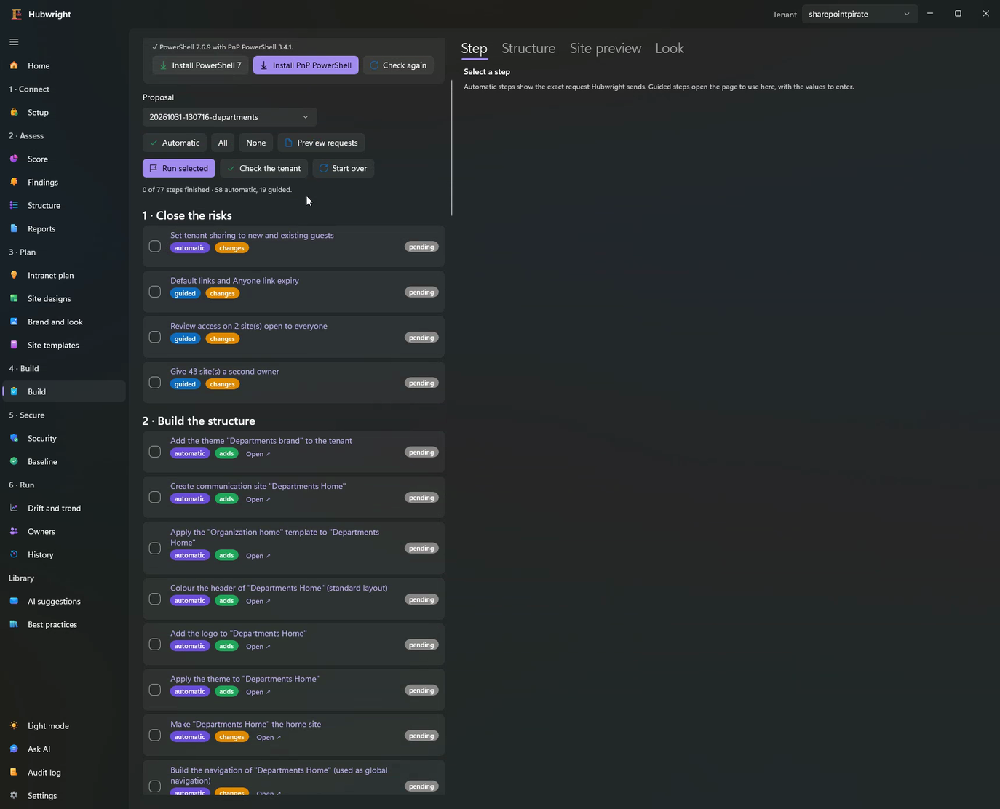
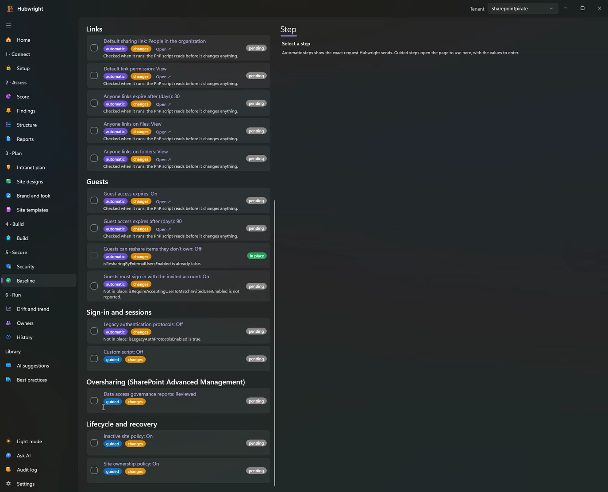
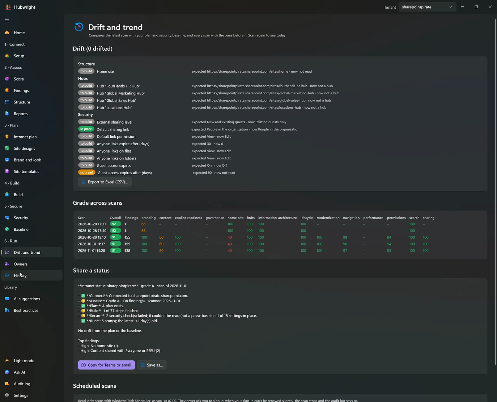

# Introduction

<p align="center">
  <a href="media/hubwright-demo.mp4"></a><br>
  <sub><a href="media/hubwright-demo.mp4">Watch the full-quality video</a> (50 seconds, no sound).</sub>
</p>

> [!WARNING]
> Hubwright is a demo, tested only on sample data and demo tenants, and its AI features only with
> the Claude Code CLI. Don't use it on a production tenant. See the [disclaimer](../README.md#disclaimer).

## Where the idea came from

I've been a SharePoint and intranet consultant for more than ten years, and I still am. Helping a
customer build a good intranet has always taken two things:

1. **Knowledge.** Microsoft's documentation, articles and best practices on site structure,
   information architecture, hub sites, navigation, the home site, permissions and sharing,
   content, lifecycle and branding. There are hundreds of pages, and they change.
2. **Experience.** Knowing how that guidance applies to *this* customer's tenant: what to keep,
   what to move, what to fix first, and how to explain why.

A consultant brings both, reads the tenant, and turns it into a plan. I kept thinking: much of that
knowledge is written down. Why not package it as a **skill set for an AI agent**? The agent could
connect to the tenant, read its current settings, use those skills to assess it, and draft a plan
and a proposal to build or improve the intranet.

Hubwright is that idea, built. I've had it in mind for a long time; this is the first working
version, shared as open source so others can try it, challenge it and add to it.

## How it works

```
  Your tenant ──read only──▶  Snapshot  ──▶  Rules (skills)  ──▶  Score and findings
                                                   │
                                                   ▼
                              Plan and proposal  ◀── AI explains and drafts the narrative
                                     │
                                     ▼
                     Build and Secure: you pick the steps and confirm
```

- **Skills are the consultant's knowledge, as data.** Each skill in [`skills/`](../skills) holds
  guidance (`SKILL.md`) and rules (`rules.yaml`). A rule is either *documented*, with the Microsoft
  Learn page and the exact sentence it enforces, or a *heuristic*, with a threshold you can tune.
  `hubwright skills refresh` checks every quote against the live page.
- **Rules decide, the AI explains.** Counts, scores, findings, placements and template choices come
  from code. The AI agent reads them through read-only tools and writes the explanation, the
  summary and suggestions. It never invents a number.
- **Reading and writing are separate.** Scans and assessments only read, with read-only
  permissions. Changes happen only in Build and Secure, only through an allow-list of documented
  APIs and PnP PowerShell cmdlets, and only after you've seen the requests and typed the tenant name.
  Nothing is ever deleted automatically.

## A tour of the six stages

### 1 · Connect
Register a read-only app once, sign in with your browser, and scan. Hubwright finds your tenant
from Microsoft Graph; you don't type it.



### 2 · Assess
A grade per category (information architecture, hubs, navigation, home site, permissions,
sharing, Copilot readiness, lifecycle, content and more), with the worst findings first. Each
finding links to the Microsoft page behind it. Anything Hubwright couldn't read is "not assessed",
never a pass.




### 3 · Plan
From the scan, Hubwright drafts a target intranet: a home site, hubs per function, a plan for every
existing site (keep, move, modernize, archive) with the reasons, new sites from Microsoft's
templates, a theme and logo checked for contrast, and a phased roadmap. The target is scored by
the same rules, so you see the improvement.




### 4 · Build
The plan becomes steps: automatic ones that use documented APIs or PnP PowerShell, and guided
ones that open the right admin page with the values to enter. Each step reads first and skips what
is already in place.



### 5 · Secure
A security baseline in three profiles (Standard, Strict, Regulated), every setting cited, read
first, applied only when you confirm, and reversible.



### 6 · Run
Drift from the plan and the baseline, the grade across scans, owner lists, and a status to paste
into Teams or an email.



## Limitations

- **Demo, not a product.** Tested on sample data and demo tenants only, never on a production tenant.
- **AI tested with one backend.** I built and tested it with my personal Claude subscription, so only
  the **Claude Code CLI** on my own computer has been tested. The GitHub Copilot CLI, Anthropic API,
  Azure AI Foundry, GitHub Models and local models (Ollama, Foundry Local, LM Studio) are implemented
  but untested. Everything except the AI explanations works without any AI.
- **Windows for the desktop app.** The CLI runs on Windows, macOS and Linux.
- **Guidance, not advice.** The rules follow Microsoft's published guidance and common practice;
  check them against your own policies.

## Get involved

- Try it on the sample tenants (`./run.ps1 -Preview`) or a test tenant: see [Getting started](getting-started.md).
- Add or improve a best practice: see [Writing skills and rules](skills.md).
- Tried another AI backend, or a bigger tenant? Open an issue and tell me what happened.
